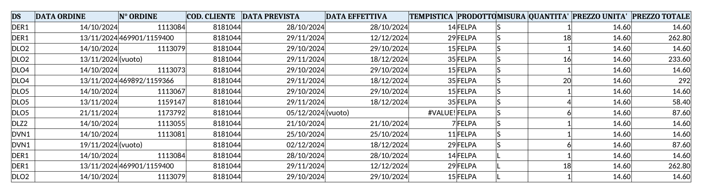

Regola unica: **ogni ordine, su qualsiasi portale, diventa righe nel foglio `Ordini_bis` di Query_DPI.xlsx prima di chiudere la giornata.** Un ordine non registrato non esiste.

| Scheda | |
|---|---|
| Trigger | Richiesta da station, giacenza sotto buffer, rampa in arrivo (inventario 6 settimane prima), nuovo ingresso driver |
| Input | Taglie (foglio `TAGLIE GLS` / `MICROMOBILITY_TAGLIE`), giacenza (foglio `Giacenza`), listino (`Scarpe_GLS`, `Divise`) |
| Passi | 1. Verifica giacenza della station per modello e taglia. 2. Compila l'ordine sul portale. 3. Salva la conferma ordine (PDF o mail) nella cartella della station. 4. Inserisci una riga in `Ordini_bis` per ogni prodotto+misura. 5. Quando arriva la merce, compila `DATA EFFETTIVA` e `N° ORDINE` se mancante. |
| Output | Righe in `Ordini_bis`, conferma ordine archiviata |
| Check finale | Somma `PREZZO TOTALE` delle righe = totale della conferma ordine. Nessuna cella vuota in DS, DATA ORDINE, PRODOTTO, MISURA, QUANTITA', PREZZO UNITA'. |

**Colonne di `Ordini_bis`**

| Colonna | Formato | Valori ammessi / regola |
|---|---|---|
| DS | testo | DER1, DER2, DLO2, DLO4, DLO5, DLZ2, DVN1, GLS (elenco a discesa) |
| DATA ORDINE | data | Giorno in cui l'ordine è confermato sul portale |
| N° ORDINE | testo | Numero del portale; se due numeri, separali con `/` (es. `469901/1159400`) |
| COD. CLIENTE | testo | Codice cliente del portale (es. 8181044 per Bruneau) |
| DATA PREVISTA | data | Dalla conferma ordine |
| DATA EFFETTIVA | data | Giorno di consegna reale; vuota finché non arriva |
| TEMPISTICA | numero | Formula `=DATA EFFETTIVA-DATA ORDINE`, mai scritta a mano |
| PRODOTTO | testo | FELPA, SCARPE, GILET, GUANTI, PANTALONE, MAGLIETTA, GIACCA (elenco a discesa) |
| MISURA | testo | Taglia (S, M, L, XL, 2XL) o numero scarpa (35-48) |
| QUANTITA' | numero | Pezzi |
| PREZZO UNITA' | numero | IVA esclusa, dal listino |
| PREZZO TOTALE | numero | Formula `=QUANTITA'*PREZZO UNITA'` |

**Esempio reale** (riga esistente)

| DS | DATA ORDINE | N° ORDINE | COD. CLIENTE | DATA PREVISTA | DATA EFFETTIVA | TEMPISTICA | PRODOTTO | MISURA | QUANTITA' | PREZZO UNITA' | PREZZO TOTALE |
|---|---|---|---|---|---|---|---|---|---|---|---|
| DER1 | 13/11/2024 | 469901/1159400 | 8181044 | 29/11/2024 | 12/12/2024 | 29 | FELPA | S | 18 | 14,60 | 262,80 |

Un ordine con 5 taglie diverse = 5 righe, stessa DATA ORDINE e stesso N° ORDINE. Il foglio `ORDINI_2026` non si usa.
