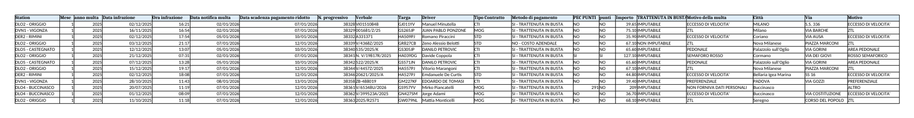
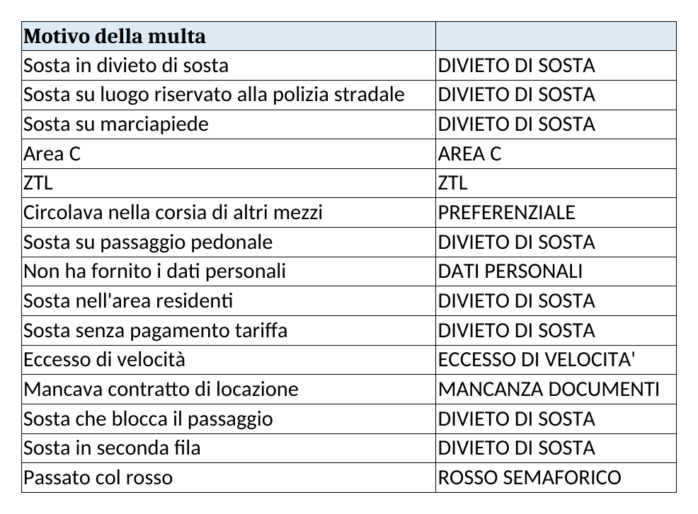

Una riga per verbale, inserita il giorno stesso in cui arriva la mail. Le colonne in grassetto sono obbligatorie già al primo inserimento; le altre si completano alla risposta della station.

| Colonna | Formato | Da dove si ricava | Valori ammessi |
|---|---|---|---|
| **Station** | testo | Lista Targhe | `DER1 - VALSAMOGGIA`, `DLO2 - ORIGGIO`, `DLO4 - BUCCINASCO`, `DLO5 - CASTEGNATO`, `DLZ2 - POMEZIA`, `DVN1 - VIGONZA` (elenco a discesa, sempre maiuscolo) |
| **Mese** | numero 1-12 | Mese della data notifica | |
| **anno multa** | numero | Anno della data infrazione | |
| **Data infrazione** | data | Verbale | |
| Ora infrazione | ora | Verbale | vuoto se assente |
| **Data notifica multa** | data | Mail Sanzioni ("notificata il") | |
| **Data scadenza pagamento** | data | Data notifica + 5 giorni | formula |
| **N. progressivo** | numero | Tra parentesi nell'oggetto della mail | es. 40689 |
| **Verbale** | testo | Oggetto mail / PDF | Copia esatta, compresi `/2026/1/1/1` |
| **Targa** | testo | Oggetto mail | 7 caratteri, senza spazi |
| Driver | testo | Risposta station | Nome Cognome |
| Tipo Contratto | testo | Risposta station | CTI, SIC, STD, MOG (elenco a discesa) |
| Metodo di pagamento | testo | Deriva dal contratto | `SI - TRATTENUTA IN BUSTA` oppure `NO - Costo Aziendale` |
| PEC PUNTI | testo | Verbale: decurtazione punti? | SI / NO |
| DATA RICHIESTA MODULO | data | Giorno in cui chiedi al driver il modulo dati conducente | nuova colonna |
| DATA INVIO PEC | data | Giorno in cui mandi il Template G a Servizi Generali | nuova colonna; se > 5 giorni dalla richiesta, avvisa Alessandro |
| punti | testo | Verbale | numero, oppure NO |
| **Importo** | numero | Verbale, importo entro 5 giorni | in euro con decimali |
| TRATTENUTA IN BUSTA | testo | | IMPUTABILE / Non imputabile |
| **Motivo della multa** | testo | Verbale, descrizione dell'infrazione | testo libero breve |
| **Città** | testo | Verbale | maiuscolo |
| Via | testo | Verbale | |
| **Motivo** | testo | Foglio `MACROAREE_VERBALI`, colonna B | DIVIETO DI SOSTA, ECCESSO DI VELOCITA', ZTL, AREA C, PREFERENZIALE, ROSSO SEMAFORICO, DATI PERSONALI, SINISTRO, AREA PEDONALE, CELLULARE, ALTRO |
| QUARTIERI | testo | Mappa città | es. NAVIGLI, PERIFERIA |
| MESE INFRAZIONE / ANNO INFRAZIONE / MESE-ANNO | formula | Da Data infrazione | `=MESE()`, `=ANNO()`, `=MESE&"-"&ANNO` |

**Esempio compilato** (riga reale del foglio)

| Campo | Valore |
|---|---|
| Station | DLO2 - ORIGGIO |
| Mese / anno multa | 1 / 2025 |
| Data infrazione / Ora | 02/12/2025 / 16:21 |
| Data notifica / Scadenza | 02/01/2026 / 07/01/2026 |
| N. progressivo | 38328 |
| Verbale | VI01510848 |
| Targa | GJ011YV |
| Driver / Tipo Contratto | Manuel Minutella / CTI |
| Metodo di pagamento | SI - TRATTENUTA IN BUSTA |
| PEC PUNTI / punti | NO / NO |
| Importo | 39,65 |
| TRATTENUTA IN BUSTA | IMPUTABILE |
| Motivo della multa | ECCESSO DI VELOCITA' |
| Città / Via | MILANO / S.S. 336 |
| Motivo (macroarea) | ECCESSO DI VELOCITA' |

Se il motivo del verbale non è nel foglio `MACROAREE_VERBALI`, aggiungilo lì prima di scriverlo nel foglio `2026`: la pivot `ANALISI` legge solo i motivi mappati.
