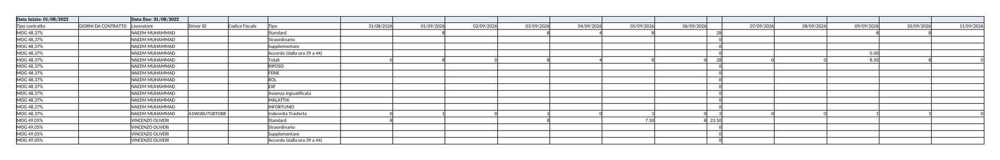
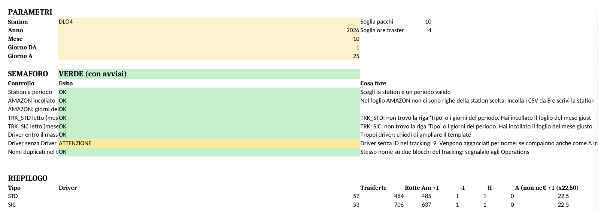
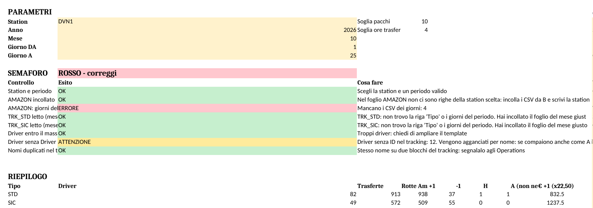
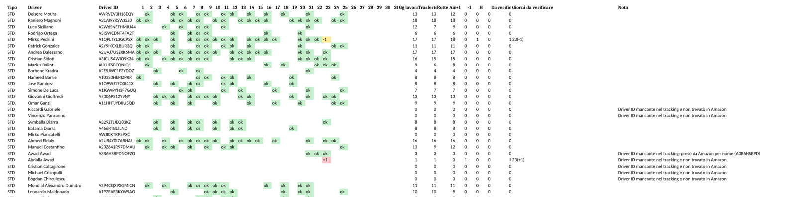

I file di tracking sono la base di tutto il costo del personale: le ore che ci sono lì finiscono in busta paga e nella stima costi. Un errore nel tracking è un errore in busta.

**I file**

| File | Uno per | Chi lo compila | Cosa contiene |
|---|---|---|---|
| `Tracking_Amazon_Driver_26_Sic_Prof_Sol_<STATION>.xlsx` | station | Station (dispatcher) | Ore giornaliere dei driver SIC/CTI: un foglio per mese, un blocco di righe per driver |
| `Tracking_Amazon_Driver_26_std_Adecco_<STATION>.xlsx` | station | Station | Stesso formato per STD e MOG |
| `Controllo_Trasferte_v3_TEMPLATE.xlsx` | uno solo, si riusa per ogni station | Stagista | Confronto presenze/trasferte del tracking con i CSV "Addetti alla consegna" del portale Amazon. Solo formule: niente macro, niente script |

**Struttura del tracking** (foglio del mese, es. `Settembre2026`): per ogni driver un blocco di righe con `Tipo` = Standard, Straordinario, Supplementare, Accordo, Totali, RIPOSO, FERIE, ROL, EXF, e una colonna per giorno. In fondo: `Ore Totali`, `ore del mese` (da contratto), `delta`, `gg delta`. La colonna `Tipo contratto` riporta il contratto e la percentuale part time (es. `MOG 48,37%`, `STD PT`).

| Scheda: controllo settimanale tracking | |
|---|---|
| Trigger | Ogni lunedì per la settimana precedente; chiusura finale entro il 1° del mese successivo (invio presenze a payroll) |
| Input | File tracking SIC e STD della station, Report ore lavorate / Doc. Harmony, Report ferie di Erika |
| Passi | 1. Apri il foglio del mese. 2. Per ogni driver verifica che la riga `Totali` sia coerente con `GIORNI DA CONTRATTO` (es. MART-VEN-SAB: ore solo in quei giorni). 3. Controlla lo split: ore oltre l'orario contrattuale devono stare in Supplementare (part time) o Straordinario (full time), non in Standard. 4. Confronta ferie/ROL/malattie con il Report ferie. 5. Segnala alla station le anomalie con una mail per station, elenco puntato: driver, giorno, cosa non torna. 6. Dopo la correzione, ricontrolla solo le righe segnalate. |
| Output | Tracking corretto; mail anomalie inviata e archiviata |
| Check finale | Per ogni driver `delta` spiegato (ferie, malattia, ingresso/cessazione a metà mese) oppure segnalato; nessuna cella con testo dove servono numeri; nessun giorno con ore su un driver in RIPOSO |

### 7b. Controllo presenze: tracking vs Amazon

Serve a intercettare, prima della chiusura payroll, tre cose: trasferte pagate ma non dovute, giornate lavorate che nel tracking non ci sono, driver nel tracking che Amazon non ha visto lavorare. Lo strumento è un solo file Excel a formule, `Controllo_Trasferte_v3_TEMPLATE.xlsx`, con cinque fogli che usi (START, AMAZON, TRK_STD, TRK_SIC, RISULTATO) e due di servizio che non tocchi (ELENCO, DETTAGLIO). Tutto quello che fai è scaricare CSV, copiare e incollare nelle celle gialle.

| Scheda | |
|---|---|
| Trigger | Ogni lunedì sui giorni fino alla domenica precedente; in ogni caso entro il 25 del mese sul periodo 1-25, per la stima parziale |
| Input | CSV Amazon per station e giorno (portale logistics.amazon.it → Performance → Addetti alla consegna); tracking STD e SIC della station, foglio del mese |
| Output | Tabella RISULTATO filtrata su "Da verificare" > 0 inviata agli Ops della station; riga RIEPILOGO di START inviata ad Alessandro |
| Check finale | Semaforo VERDE in START; dopo le risposte degli Ops, tracking reincollato e alert residui contati |

**Passo 1 – Scarica i CSV Amazon**

1. Portale logistics.amazon.it → Performance → Addetti alla consegna.
2. Seleziona la station e il giorno → Download. Se il portale permette un intervallo di date, scarica un solo CSV per station e periodo: il formato è lo stesso.
3. Salva come `<STATION>_<giorno>.csv` (es. `DER2_5.csv`) nella cartella del mese, una sottocartella per station.

**Passo 2 – Foglio START**

Scegli Station dal menu a tendina, poi Anno, Mese, Giorno DA, Giorno A. Le soglie (pacchi 10, ore trasferta 4) sono già impostate: non cambiarle.

**Passo 3 – Incolla i dati (solo celle gialle)**

1. Foglio AMAZON: apri un CSV con Excel, seleziona le righe **senza l'intestazione**, copia, incolla nella prima riga libera **a partire dalla colonna B** (la colonna A è per la station). Scrivi la sigla della station in colonna A **solo sulla prima riga del blocco** appena incollato: le righe sotto la ereditano da sole. Ripeti per tutti i CSV, uno sotto l'altro, di tutte le station: il foglio AMAZON si riempie una volta al mese e vale per tutte le station.
2. Foglio TRK_STD: apri il tracking STD della station, foglio del mese (es. `10.26` o `Ottobre`), Ctrl+A, Ctrl+C, poi nel template cella A1 → tasto destro → Incolla speciale → **Valori** (icona 123).
3. Foglio TRK_SIC: stessa cosa con il tracking SIC.
4. Al primo incolla il file ricalcola per 20-60 secondi: aspetta che in basso sparisca "Calcolo".

Alternativa senza incolla (la imposta Alessandro una volta, solo Excel): Dati → Recupera dati → Da file → Da cartella → cartella dei CSV → Combina e trasforma; colonna personalizzata `Station = Text.Start([Source.Name],4)` portata per prima; Carica in → Foglio esistente → `AMAZON!$A$2`. Da quel momento metti i CSV nella cartella e fai Dati → Aggiorna tutto.

**Passo 4 – Semaforo in START**

| Semaforo | Cosa significa | Cosa fai |
|---|---|---|
| VERDE | Tutto letto | Vai in RISULTATO |
| VERDE con avvisi | Ci sono driver senza Driver ID nel tracking: il file li aggancia per nome | Va bene, ma segnala agli Ops di inserire gli ID |
| ROSSO | La riga rossa dice cosa manca: CSV di un giorno, tracking del mese sbagliato, incollato non in A1, CSV incollato dalla colonna A | Correggi quello che dice la riga; se non si risolve, screenshot di START ad Alessandro |

**Passo 5 – Invio agli Ops**

1. In RISULTATO filtra la colonna "Da verificare" > 0, copia le righe (Tipo, Driver, Driver ID, Giorni da verificare, Nota).
2. Mandale al responsabile Operations della station (per DLO2 e DLO4 Marco Carretta; gli altri referenti nella tabella capi station, sezione 1). Chiedi risposta entro 2 giorni lavorativi.
3. Le risposte arrivano come correzioni sui tracking: reincolla il tracking corretto e ricontrolla.
4. Copia ad Alessandro la riga RIEPILOGO di START (Trasferte, Rotte Amazon, +1, −1, H, A, € +1).
5. Per un'altra station: Salva con nome, cancella TRK_STD e TRK_SIC (Ctrl+A, Canc), cambia Station in START. AMAZON resta com'è.

**Simboli del foglio RISULTATO** (una riga per driver, una colonna per giorno)

| Simbolo | Significato | Cosa fare |
|---|---|---|
| ok | Trasferta nel tracking e rotta Amazon coincidono | Nulla |
| +1 | Trasferta pagata ma Amazon non lo vede in rotta quel giorno (o ha lavorato ≤ 4 ore) | Chiedere agli Ops cosa ha fatto. Se MEZZI, altra station o corso: devono scriverlo nella riga RIPOSO |
| −1 | Amazon lo vede in rotta ma nel tracking ha 0 ore | Giornata mancante nel tracking: gli Ops la inseriscono |
| H | Ore nel tracking ma assente in Amazon, senza trasferta e senza giustificativo | Chiedere cosa ha fatto (spesso mezzi o errore di compilazione) |
| A | Driver con rotta in Amazon ma assente da entrambi i tracking | La Nota dice se è presente in Amazon su un'altra station (prestito: cercarlo in quel tracking) oppure se è un nuovo assunto o dimesso non ancora inserito |
| vuoto | Niente da segnalare | Nulla |

La colonna "Giorni da verificare" è l'elenco già pronto dei giorni con simbolo, da copiare nel messaggio agli Ops.

**Regole fisse del file**

- Rotta Amazon = pacchi consegnati > 10. Trasferta dovuta solo con ore lavorate > 4: i servizi da 4 ore non generano alert.
- Trasferta a 0 nel tracking non genera mai alert: se gli Ops l'hanno messa a zero, è voluto.
- Un codice della lista Giustificativi nella riga RIPOSO chiude il giorno senza alert: MEZZI, SM (spostamento mezzi), UFF, CORSO, FORMAZIONE, RESCUE, VM, DVN5, DVN6 e le sigle o i nomi delle altre station (DLO4, ORIGGIO, BUCCINASCO…). La lista è modificabile in START.
- I commenti nelle celle **non vengono letti**: il codice va scritto nella riga RIPOSO. È l'errore più frequente (DVN1 e DLO5 scrivono "mezzi" nei commenti e generano decine di +1 falsi).
- I Dispatcher (elenco in START, cognome + nome) sono esclusi: non guidano, non hanno trasferta.
- Codici che non sono giustificativi: SB (turno Same B), L1 (rotta standard 8 ore facilitata), R, C1, D, F, P. Se c'è un codice di assenza ma anche ore lavorate, è un errore di compilazione da segnalare.

**Attenzione: trappole note**

| Caso | Come si presenta | Cosa fare |
|---|---|---|
| Driver di una station che lavora in un'altra (DLO2 ↔ DLO4 spesso) | A nella station Amazon, +1 o H nella station del tracking | Si chiude da solo se gli Ops scrivono la sigla della station nella riga RIPOSO |
| Nome scritto diverso (D'Andrea / Dandrea, Amin Elkadimi / Amin Skalli Elkadimi) | Il file aggancia se primo e ultimo nome coincidono; altrimenti un A e un +1 sullo stesso periodo | È la stessa persona: far inserire il Driver ID nel tracking |
| Due account Amazon per lo stesso driver | Stesso effetto | Stessa soluzione: Driver ID nel tracking |
| Driver con contratto scaduto ancora attivo in Amazon (es. Manfredi DLO4, 3/10) | A senza altra station in Nota, non confermato come nuovo assunto | Subito ad Alessandro, non agli Ops: possibile uso improprio dell'account |
| Tracking che sconfinano nel mese precedente o successivo (DLO4, DLO5, DVN1) | Nessun sintomo | Il file legge solo i giorni del periodo scelto: non modificare le date in intestazione |
| CSV incollato dalla colonna A | Semaforo ROSSO su "AMAZON incollato" | Cancella e reincolla dalla colonna B |
| Data del CSV nel formato 2026-10-05 | Excel la riconosce; se resta testo il file la converte comunque | Nulla |
| Righe o colonne inserite, fogli rinominati, scritte fuori dalle celle gialle | Formule rotte | I fogli sono protetti senza password proprio per questo: non togliere la protezione |

**Escalation**

- Ops che non rispondono entro 2 giorni lavorativi → Alessandro.
- Semaforo ROSSO che non si risolve → Alessandro con screenshot di START.
- Driver sconosciuti (A) senza altra station in Nota e non confermati dagli Ops come nuovi assunti → Alessandro.

Esempi da tenere accanto al template: `Controllo_Trasferte_v3_ESEMPIO_DLO4.xlsx` (ottobre 1-25, semaforo verde, caso pulito) e `Controllo_Trasferte_v3_ESEMPIO_DVN1.xlsx` (tracking senza ID, giustificativi nei commenti, manca un CSV: tutte le trappole in un file).
