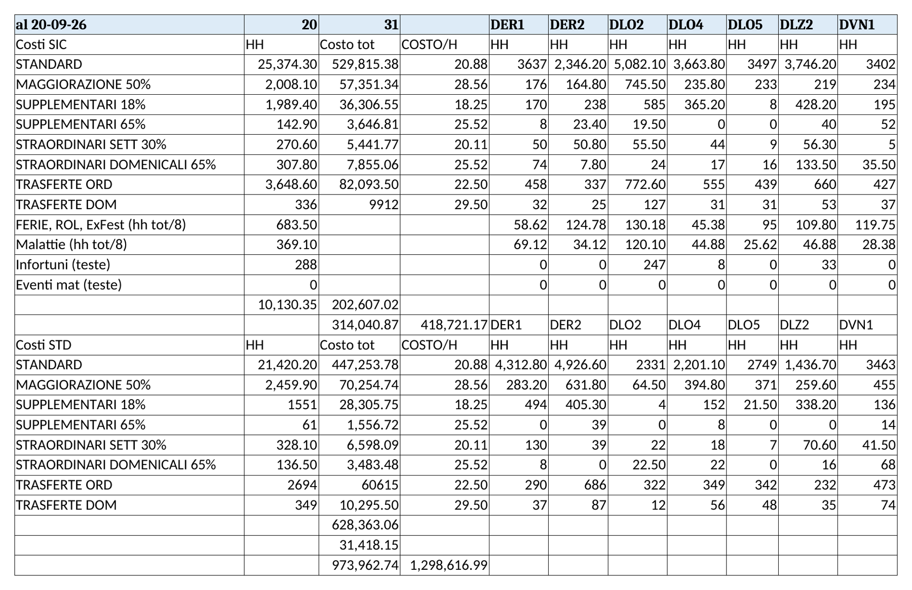
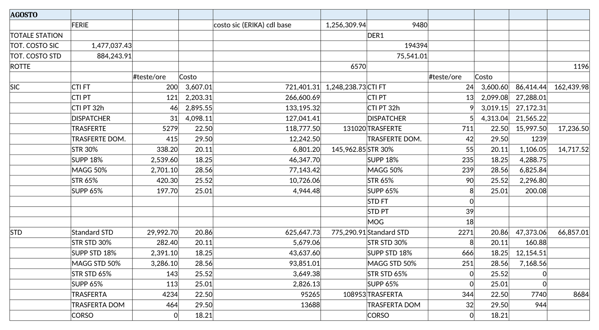

Due momenti, due file, stessa logica: ore per categoria × costo orario = costo del mese. La parziale serve ad Annalisa per la stima; la totale chiude il mese.

| | Stima parziale | Stima totale |
|---|---|---|
| File | `Stima_Costi.xlsx`, un foglio per mese (`Sett_26`) | `Stima_Costo_personale.xlsx`, un foglio per mese e perimetro (`AMZ_SEP_26`, `GLS_AGO_26`) |
| Quando | Terza settimana del mese (es. "al 20-09-26") | Fine mese, a tracking chiuso |
| Input | Tracking SIC e STD di tutte le station, parziali | Tracking finali, teste per contratto, costo orario (foglio `Costo orario`) |
| Granularità | Ore per categoria e station, SIC e STD separati | Teste per contratto (CTI FT, CTI PT, CTI PT 32h, Dispatcher, STD FT, STD PT, MOG) + ore per categoria + costo per station |
| Destinatario | Annalisa Pinazzi | Annalisa Pinazzi, Valerio |

**Categorie di ore (uguali nei due file)**

| Categoria | Da dove nel tracking |
|---|---|
| STANDARD | Riga `Standard` |
| MAGGIORAZIONE 50 | Domenica lavorata entro l'orario ordinario e festività infrasettimanali (+50%, Accordo art. 22f, CCNL art. 12) |
| SUPPLEMENTARI 18 | Riga `Supplementare`: ore di un part time in un giorno non previsto dal contratto (es. PT24 lun-mar-mer che lavora giovedì e venerdì), feriale o sabato (+18%, CCNL art. 56 c.16) |
| SUPPLEMENTARI 65 | Riga `Supplementare` di domenica (+65%, Accordo art. 22f) |
| STRAORDINARI SET (STR 30%) | Riga `Straordinario`: ore oltre l'orario ordinario in giorno feriale o di sabato, incluso il sesto giorno (+30%, CCNL art. 13 c.6 personale viaggiante) |
| STRAORDINARI DOM (STR 65%) | Riga `Straordinario` di domenica, oltre l'orario ordinario (+65%, Accordo art. 22f) |
| SUPP 40% | Supplementare oltre il 30% annuo della prestazione concordata (+40%, CCNL art. 56 c.17): oggi non tracciato, serve il contatore annuo per driver |
| TRASFERTE ORD / TRASFERTE DOM | Giorni con trasferta, feriali / domenica (dal controllo trasferte, sezione 7) |
| FERIE, ROL, ExFe / Malattie / Infortuni / Eventi mat. | Righe FERIE, ROL, EXF e assenze (ore o teste, come indicato nella riga) |

Regola in una frase: le ore nei giorni **non previsti dal contratto** sono supplementari; le ore **oltre l'orario ordinario** (42 h/settimana, 8h24/giorno per i driver in regime di discontinuità, Accordo art. 4) sono straordinario; feriale e sabato = 30%, domenica = 50% entro l'orario e 65% oltre. Base full time = quella dell'Accordo, 42 h/settimana: non si usano altre basi. Prima stima da fare con Alessandro accanto per verificare l'attribuzione.

| Scheda: stima parziale | |
|---|---|
| Trigger | Terza settimana del mese |
| Passi | 1. Duplica il foglio del mese precedente, rinominalo `<Mese>_26`. 2. In A1 scrivi "al GG-MM-AA" con la data dell'ultima domenica per cui hai i tracking completi (la terza settimana del mese, di norma), in B1 il giorno di taglio, in C1 i giorni del mese (servono alla proiezione). 3. Per ogni station e categoria inserisci le ore cumulate al giorno di taglio, prima il blocco SIC poi il blocco STD. 4. Non toccare `COSTO/H` e `Costo tot`: sono formule. 5. Verifica che la cella di controllo mostri `OK`. 6. Invia ad Annalisa il totale proiettato. |
| Check finale | Cella controllo = OK; somma HH per station = totale ore tracking della station alla stessa data; nessuna categoria a zero dove il mese prima era > 0 senza un motivo |

| Scheda: stima totale | |
|---|---|
| Trigger | Fine mese, dopo l'invio presenze finali a payroll |
| Passi | 1. Duplica il foglio del mese precedente (`AMZ_<MESE>_26` e, se serve, `GLS_<MESE>_26`). 2. Aggiorna le teste per contratto in `#teste` per station. 3. Inserisci le ore finali per categoria, blocco SIC e blocco STD, per ogni station. 4. Costo orario: solo dal foglio `Costo orario`, mai modificato a mano in riga. 5. Confronta `TOT. COSTO SIC` e `TOT. COSTO STD` con la stima parziale: scostamento oltre il 10% va spiegato in una riga. |
| Check finale | Totale ore = totale tracking finale; totali station che sommano al totale generale; scostamento vs parziale spiegato |
